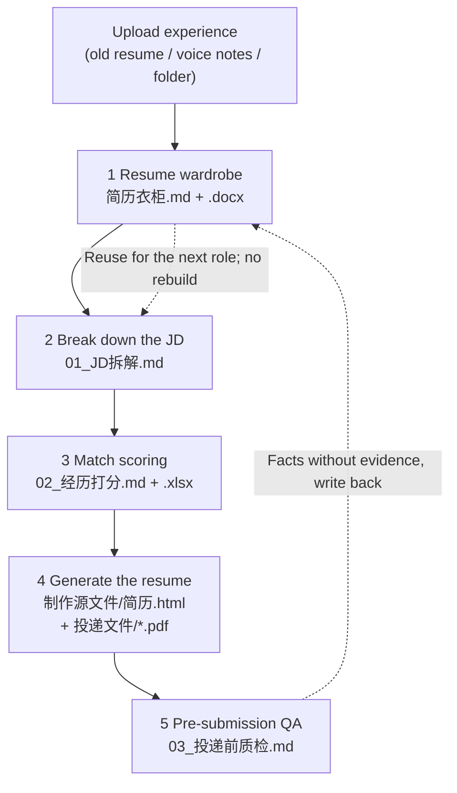
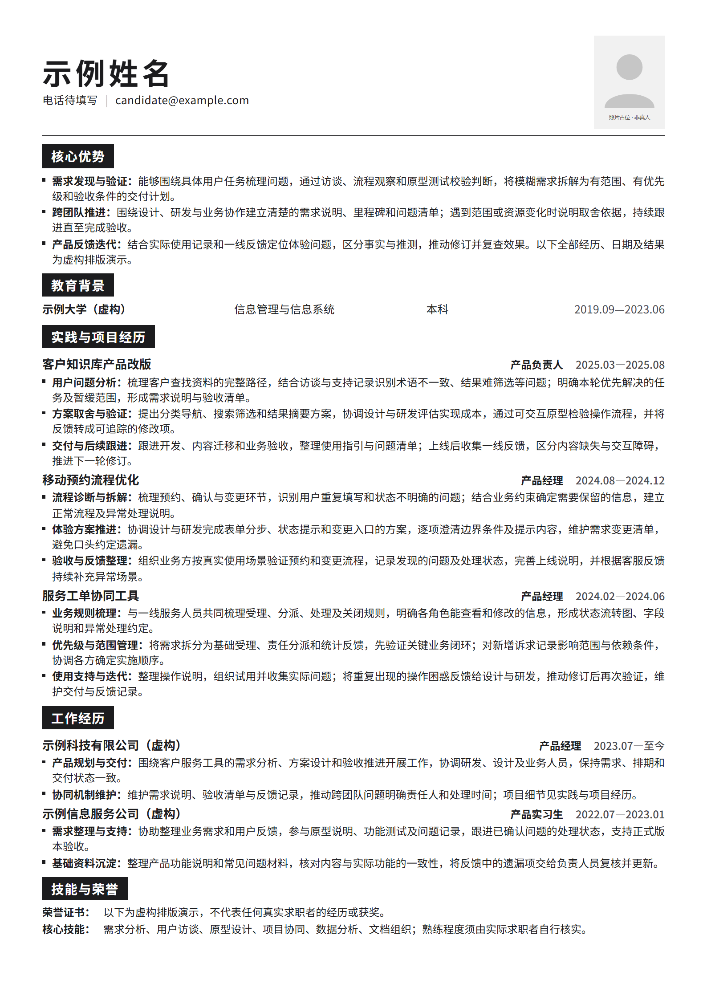

# Resume Polish · A Five-Step One-Page Resume Skill

**English** | [中文](README.md)

> **Note:** this skill is built for the Chinese job market. Its prompts, templates, and resume output are in Chinese; this README is the English guide to what it does and how to install it.

Turn an old resume, scattered experience, or a rambling voice memo into a Chinese-language resume tailored to a target role: **one A4 page, a minimal black-and-white layout, core projects given room to breathe, and an optional professional headshot.**

What this repo shares is one layout and one production method. Everyone's resume content comes from their own real experience; do not copy the author's or the examples' histories.

## How to use it (five steps)

**Install it into your agent (clone recommended — later updates are one command):**

**① Clone into your personal skills directory** (recommended)

> **The example below uses ZCode**, whose personal skills directory is `~/.zcode/skills`. **Other agents use different paths** — replace the first line with your own agent's skills directory; the rest of the commands stay the same. If you are not sure, ask it: "Where is your personal skills directory?"
> If your agent has no concept of a "skills directory", cloning anywhere works too — **a skill is just a folder containing `SKILL.md`**; point the agent at that folder. You only lose the automatic-triggering layer.

```bash
cd ~/.zcode/skills                                  # ← ZCode's skills directory; use yours
git clone https://github.com/Fanghj256/resume-polish.git resume-polish
cd resume-polish
npm ci && npx playwright install chromium           # required for PDF export
python -m pip install pymupdf python-docx openpyxl  # for existing PDFs and Word/Excel export
```

**② Let your agent install it** (the lazy version, same result) — just say:

```text
Install this skill for me: https://github.com/Fanghj256/resume-polish
Use git clone into your personal skills directory (do not unzip a ZIP), and install the dependencies: npm ci, npx playwright install chromium, pip install pymupdf python-docx openpyxl
```

**③ Download the ZIP** (fallback when the network is bad): [Download the skill ZIP](https://github.com/Fanghj256/resume-polish/releases/latest/download/resume-polish.zip). Unzip it, put the `resume-polish` folder in your skills directory. **The trade-off: no automatic updates** — you will need to download and overwrite it again later.

**Updating after installation**

```bash
cd ~/.zcode/skills/resume-polish && python scripts/update_self.py   # use your actual install path
```

It checks that this is a git clone, that there are no uncommitted changes, then runs `git pull --ff-only`; it installs dependencies **only when `package.json` changed**. If you installed from a ZIP, it tells you how to update manually. You can also just tell your agent "update resume-polish".

**Mainland China network**: `github.com` is intermittent. A failed clone or update does not mean the repo is broken — see [China network & mirrors](references/mirror-and-network.md) (mirror usage and how to host your own).

**Two things to keep in mind**:

- **Dependencies are required, or you get no PDF**: the repo does not include `node_modules`. PDF export needs `npm ci` + `npx playwright install chromium`; existing PDFs and Word/Excel output also need `pip install pymupdf python-docx openpyxl`. The steps before dependency installation (wardrobe, JD breakdown, scoring, drafting bullets) still work. Commands: [scripts/README.md](scripts/README.md).
- **Giving the agent only `SKILL.md` will not work**: templates and scripts live in the folder; without them, no resume comes out.

A plain chat-only window (no file access, no command execution) cannot install it; it can help write content, but cannot produce a PDF.

### Next: pick a data directory and run the five steps

**The data directory defaults to `~/我的简历/` ("my resumes"; on Windows usually `C:\Users\<you>\我的简历`)** — the wardrobe, source material, and application files all live here, **outside the skill folder**. The agent creates it on the first conversation and tells you where it is; you can move it anytime.

**Why keep them separate**: the skill gets upgraded and overwritten, and may be made public, while the wardrobe is the single master copy of all your experience (lose it and you cannot rerun; unlike intermediate PPT files). So it must live somewhere that will not be wiped wholesale or accidentally uploaded.

Step 1 is done once; steps 2–5 run for every job you apply to:

| Step | What you do | What you get |
| --- | --- | --- |
| **1 Build the resume wardrobe** | Hand over your experience: drop in an old resume, talk freely, or point it at a folder | `简历衣柜/简历衣柜.md` + `简历衣柜.docx`: each experience filed by period / organization / role / context / action / result / tools / skill tags. **Say "记衣柜：…" (note to wardrobe) anytime to update it** |
| **2 Break down the JD** | Send the **full JD** for the target role (or a job link or screenshot) | `01_JD拆解.md`: the five capabilities the role really cares about, screening keywords, hard requirements and nice-to-haves, and where the JD itself is vague |
| **3 Select experience** (skippable) | It asks whether you want scoring; if yes, tick "use" and set "resume order" in the Excel file it sends back | `02_经历打分.md` + `.xlsx`: a 1–5 match score per experience, keep / compress / drop advice, and how to fill requirements that lack evidence |
| **4 Generate the resume** | Confirm the selection and order | A PDF in `投递文件/`, plus `制作源文件/简历.html` — **double-click to edit the text in your browser**; when done, say "同步投递件" (sync application files) to re-export |
| **5 Pre-submission QA** | Send the final draft back and say which role it targets (with the JD) | `03_投递前质检.md`: typos, number provenance, sensitive information, keywords without evidence, with a "must fix / should fix / optional" list |

### What you get when the workflow is done



**Your data directory ends up looking like this** (names are customizable; you choose the location):

```text
我的简历/                          ← all personal data lives here, not in the skill folder
├── 简历衣柜/
│   ├── 简历衣柜.md                structured master copy of all experience (single editable source)
│   └── 简历衣柜.docx              reading copy, generated by script
├── 素材/                          photos, original resumes, certificates
└── 简历投递/
    ├── 投递台账.xlsx               one sheet tracking every application
    └── 字节跳动_标准知识库运营/      ← one folder per role
        ├── 00_进度与说明.md         current step and what needs your confirmation
        ├── 01_JD拆解.md
        ├── 02_经历打分.md / .xlsx
        ├── 03_投递前质检.md
        ├── 投递文件/                PDF, preview.png
        └── 制作源文件/              简历.html (double-click to edit), assets/
```

Each application adds one folder, and every artifact goes where it belongs — you never create directories yourself. The wardrobe is built once and shared by every later role: **the more you apply, the more time it saves.**

### Sample prompts for each step

> The skill's own trigger phrases are Chinese. The English prompts below are for reference; if your agent ignores one, add the matching Chinese trigger: 记衣柜 / 拆解 JD / 打分 / 同步投递件 / 投递前质检.

**1 Build the resume wardrobe** (once)

```text
Build my resume wardrobe first. My experience is in this folder: [path / files attached]. A few more things: [say whatever comes to mind; skip what you don't remember]
```

> You can start without an old resume — just talk. It turns the facts into the wardrobe first, then asks about gaps in one batch.

**2 Break down the JD**

```text
Break down this role for me: [paste the full JD]. Judge the industry as [internet content platform / financial regulation / state-owned enterprise general management / …].
```

> A job title alone is usually too little — **send the full JD, or a job link or screenshot together with it**.

**3 Score the experience** (answer this when it asks)

```text
Yes, score them for me. Also tell me which ones to compress or drop so I can tick them in Excel.
```

> If you don't need it, say "skip this step and generate directly". After you get `02_经历打分.xlsx`, change **only the "采用" (use) and "简历顺序" (resume order) columns** and send it back:

```text
Excel attached: use E01, E03, E05; order 1, 2, 3; keep E04 as a backup for now.
```

**4 Generate the resume**

```text
Generate the resume from my selections and put it in 简历投递/[company_role]/. After generating, list which wardrobe entry each bullet came from.
```

> Once you have the HTML, **double-click to edit the text in the browser**; when done, say "**同步投递件**" (sync application files) to re-export the PDF. The editing layer has a "copy message for the agent" button that puts that sentence on your clipboard.

**5 Pre-submission QA**

```text
QA this before I apply: the role is [company + title], the JD is [paste / link]. Focus on whether the numbers hold up and whether there are JD keywords I have no evidence for.
```

> You don't need to remove your phone number or email; it focuses on ID numbers, home addresses, internal company material, other people's private data, and similar.

In a hurry, one sentence can start it: `Use resume-polish to build my resume; materials are in [path], target is [role + JD]` — it starts from the wardrobe, **but stops at every step for your response**: it shows you the JD breakdown, waits for your selections after scoring, and only generates the resume after you confirm.

**Want only one step?** (for example, just the scoring result) Just say so: "Break down this JD first, don't generate a resume", "Only do the scoring, wait for my selections".

### How to invoke it

The skill name is **`resume-polish`**. Once installed, you don't need to memorize commands — these three ways are enough:

| Method | What to say | Notes |
| --- | --- | --- |
| **Explicit invocation** (most reliable) | `/resume-polish`, or "**use resume-polish** to break down this JD" | Type it directly in hosts that support slash commands; it forces the skill to load |
| **State the need** | "Break down this JD", "Add this week's experience to the wardrobe", "QA this before I apply" | The model decides from the skill description; enough for daily use |
| **Fixed phrases** | "**记衣柜：**…" (note to wardrobe), "**衣柜体检**" (wardrobe checkup), "**同步投递件**" (sync application files), "**投递前质检**" (pre-submission QA) | Once the skill is loaded, these four phrases drive the matching action |

**If it doesn't trigger**, say "use resume-polish for this", or mention the skill name in your message.

Two honest caveats: whether the skill is invoked **is decided by the model; there is no hard keyword match** (we have put "resume wardrobe", "break down JD", "scoring", "QA", and "note to wardrobe" into the skill description, but it only sees the first ~250 characters); and host agents differ in skill support — another agent may need different phrasing, or may not support skills at all. A hard guarantee that "saying word X always triggers" requires a trigger-word mapping in the agent's global instructions; that is local configuration, not something this skill ships.

Photos follow step 4: if you have a suitable photo of yourself, it goes on the resume; if you only have casual photos, the built-in business-headshot workflow guides you through making one; if the role requires no photo or you don't want one, it complies.

## You can start with incomplete information

You don't need to fill out a complete questionnaire first. The agent reads the material you already have, then looks for gaps against the role, asking 1–3 key questions per round, such as "which parts did you personally own", "how did you make trade-offs", and "what was delivered in the end". You can just talk; the answers are filed back under the matching project.

If you can't remember a number, say so. With no data, you can substitute actual deliverables, usage feedback, or follow-up actions. If you didn't do something, say so directly — the skill looks for related abilities in other real experience and will not invent achievements for you. The intake process is described in [Intake and follow-up](references/intake-and-follow-up.md).

## Style preview

The material below is **entirely fictional**. Names, companies, schools, projects, dates, numbers, and photo placeholders do not represent the author or any real applicant and must not be used to apply.



You can open the [demo HTML](examples/demo.html). Double-click it in Chrome/Edge and the edit toolbar is at the top: click "start editing" to change text directly, see how many millimeters are left on the page, click "hide private info" to mask phone and email, and click "export PDF" to print. In real use, the content is replaced with your material and your own photo; the demo contains no real person's photo.

## What this skill includes

- Matching role responsibilities against experience evidence, not just swapping job titles and keywords.
- **A five-step workflow and prompt templates for all five stages**: build the wardrobe → break down the JD → match scoring → write bullets → pre-submission QA.
- **The resume wardrobe**: structured experience profiles (period / organization / role / context / action / result / tools / skill tags), invested once and reused many times; new facts can be written back with "记衣柜" (note to wardrobe) anytime. The more you apply, the more it saves.
- Five-element expansion for internships and practice experience, fact boundaries, single-page density, and overflow handling.
- A fixed A4 template, a header-with-photo variant, and PDF rendering and checking scripts.
- The delivered `简历.html` ships with an in-browser editing layer: double-click to edit, see remaining page space, hide contact details, export a PDF, and write it back to the source file.
- A built-in business-headshot prompt, identity-preservation, and final-image review workflow.
- A convention for organizing deliverables by company and role.

## Requirements

You need an agent that can read an entire folder. PDF generation uses Node.js 20+, Playwright, and Chromium; handling existing PDFs can use Python 3.10+ and PyMuPDF. You can leave installation and execution to the agent; detailed commands are in [scripts/README.md](scripts/README.md).

The skill contains no model, image-generation service, account, or API key. If your environment cannot execute code, it can still read the guidelines and help write content, but it must not claim a PDF was exported. Fonts differ slightly across systems; always check the actual PDF.

## Privacy

This repository was created from an empty history and provides only a general method and fictional examples. It contains no real resume, phone number, email, photo, or application record of the author. The only public attribution is the GitHub account.

Keep personal data in your own resume project; do not upload it to this repository's Issues, Pull Requests, or examples directory. The scripts read and render material locally and do not upload resumes to a server; if you separately use a cloud agent or image service, that service processes the material.

**The data directory and the skill directory must stay separate**: the wardrobe, assets, and application files are personal data and belong in the data directory you choose; the skill directory holds only templates, scripts, and docs. The skill is upgraded and overwritten, and may be made public — mixing personal data into it means risking both overwrite and disclosure.

The photo workflow reuses `american-business-headshot`, published independently by the author; the license is kept in the [built-in workflow directory](references/american-business-headshot/LICENSE).

## Origin and originality

This repo is a derivative of [xupengli406-del/resume-builder](https://github.com/xupengli406-del/resume-builder):

- **Inherited from upstream (presentation layer)**: the A4 one-page template and visual rules, examples, PDF export chain, intake and follow-up, and the business-headshot workflow.
- **New in this repo (method and tooling layer)**: the five-step workflow, resume wardrobe, prompt library, in-browser editing layer, single-page ruler and editor smoke-test scripts, wardrobe → Word and score sheet → Excel export, directory conventions, and progress cards.

Upstream's idea is "upload JD + experience → generate one resume"; this repo first turns experience into a reusable wardrobe, then runs only the last four steps for each application. See [ATTRIBUTION.md](ATTRIBUTION.md) for an item-by-item comparison and [NOTICE.md](NOTICE.md) for the license scope (MIT covers this repo's original parts; reused parts remain copyright their original author, with permission).